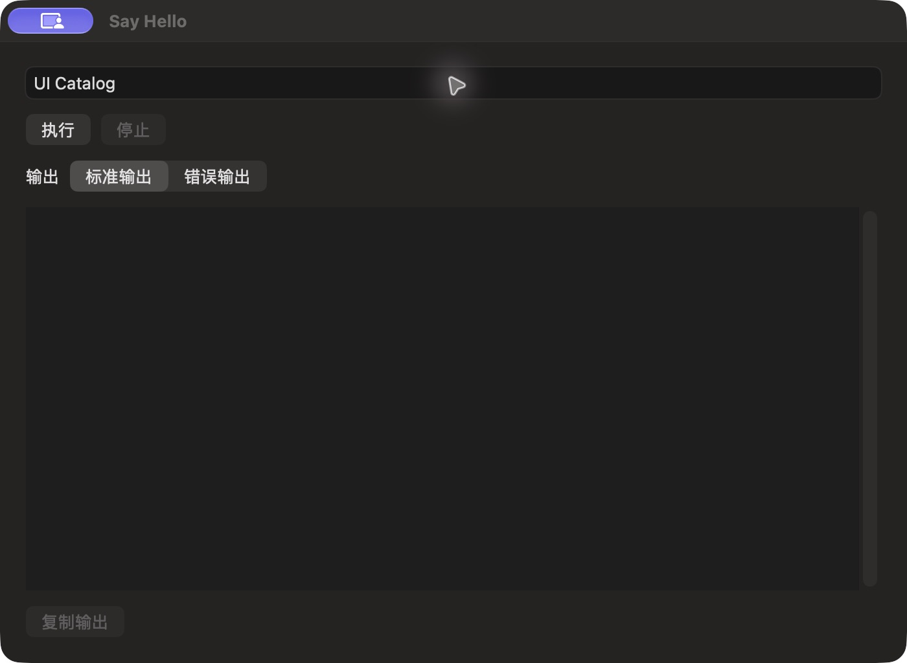

# Hello 扩展运行参数

批次 G · 2026-10-31，正常 dev `2f41c6a` 构建，版本 1.0（1）。

进入路径：主搜索 → Say Hello。

状态和操作：Name 填写 UI Catalog，尚未执行。



## 可见范围

深色外观，仅当前可见窗口。工具输出已转换为真实 PNG，未缩放或重绘。公开样例仅在本机使用，没有复制结果或上传。功能恢复及保留的测试数据见总索引。

## 源码

`zbox/ExternalExtensions/ExtensionTaskSession.swift:70`，文案资源 `zbox/Localizable.xcstrings`。以下局部 UI 摘录省略其余依赖，不能独立运行。

```swift
    var body: some View {
        VStack(alignment: .leading, spacing: 12) {
            ForEach(Array((session.command.parameters ?? []).enumerated()), id: \.element.id) { index, field in
                TextField(field.name, text: $session.values[index]).disabled(session.running)
            }
            HStack {
                Button("Run", action: session.run).keyboardShortcut(.return, modifiers: .command).disabled(session.running)
                Button("Stop", action: session.cancel).disabled(!session.running)
                if session.running { ProgressView().controlSize(.small) }
                if let result = session.result {
                    Text(result.cancelled ? String(localized: "Cancelled") : result.timedOut ? String(localized: "Timed Out") : result.terminationDescription)
                }
            }
            Picker("Output", selection: $stderr) {
                Text("Standard Output").tag(false); Text("Standard Error").tag(true)
            }.pickerStyle(.segmented)
            PlainTextEditor(text: .constant(text), isEditable: false, label: String(localized: "Output"))
            Button("Copy Output") { session.copy(text) }.disabled(text.isEmpty)
            if session.output.truncated { Text("Output limited to 1 MiB per stream.").font(.caption) }
            if let error = session.error { SettingsErrorView(message: error) }
        }.padding(20)
    }
}
```
