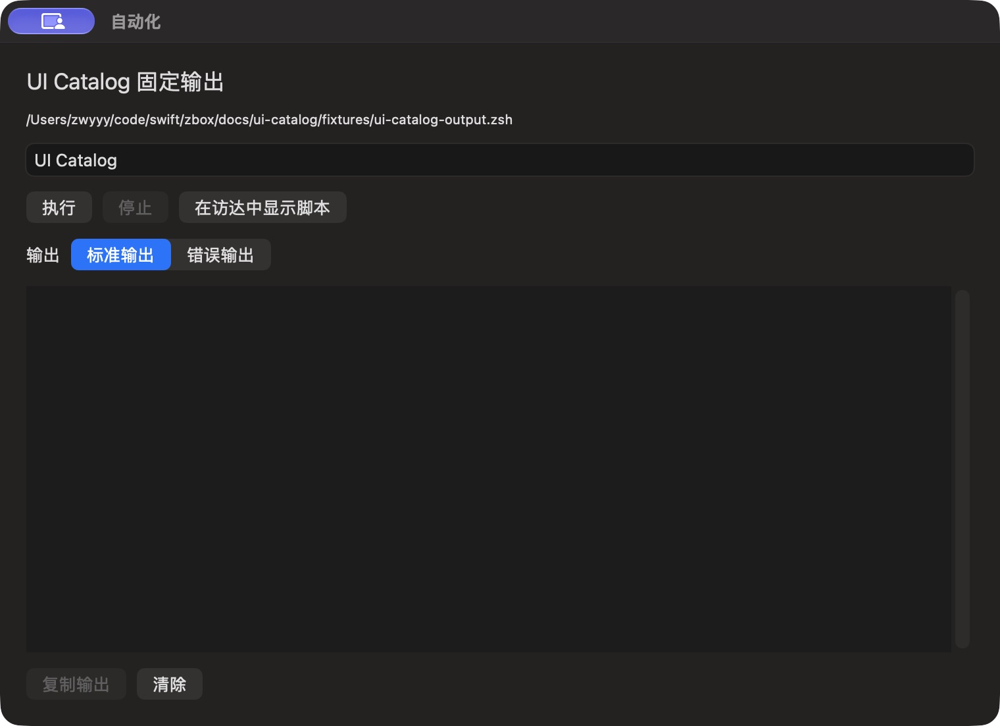

# 自动化运行参数

批次 H · 2026-10-31 至 2026-11-01；dev `2f41c6a` 临时采集构建，版本 1.0（1）。

进入路径：主搜索 → UI Catalog 固定输出。

状态和操作：运行前显示参数，默认值 UI Catalog；随后仅运行已授权固定输出脚本一次。



## 可见范围与构建差异

深色外观，仅当前实际可见窗口。截图转为真实 PNG，保留原始尺寸，未重绘。为工具导航临时增加普通菜单入口、启动时展示主搜索，放宽主搜索失焦关闭，并给截图选择浮层添加窗口标题元数据；业务命令仍经原有入口执行。这些临时源码在结束时全部恢复，不能用本批证明正式版本焦点行为正确。测试数据和恢复记录见总索引。

## 源码

`zbox/Plugins/ScriptCommands/ScriptCommandsPlugin.swift:185`；文案资源 `zbox/Localizable.xcstrings`。以下局部摘录省略其余依赖，不能独立运行。

```swift
    var body: some View {
        VStack(alignment: .leading, spacing: 12) {
            if let item = plugin.selected {
                Text(item.name).font(.title2)
                Text(item.shortcut?.name ?? item.path).font(.caption).textSelection(.enabled)
                if let shortcut = item.shortcut {
                    if shortcut.acceptsText {
                        PlainTextEditor(text: $plugin.shortcutInput, label: String(localized: "Shortcut Input"))
                            .frame(height: 90).disabled(plugin.isRunning)
                    }
                    Text("Stopping or timing out only stops waiting in zbox. The shortcut may continue in Shortcuts.")
                        .font(.caption).foregroundStyle(.secondary)
                } else {
                ForEach(Array(item.parameters.enumerated()), id: \.element.id) { index, parameter in
                    TextField(parameter.name, text: $plugin.values[index]).textFieldStyle(.roundedBorder)
                        .disabled(plugin.isRunning)
                }
                }
                HStack {
                    Button("Run", action: plugin.run).keyboardShortcut(.return, modifiers: .command).disabled(plugin.isRunning)
                    Button(item.shortcut == nil ? String(localized: "Stop") : String(localized: "Stop Waiting"), action: plugin.cancel).disabled(!plugin.isRunning)
                    if item.shortcut != nil {
                        Button("Open in Shortcuts", action: plugin.openShortcut)
                    } else {
```
