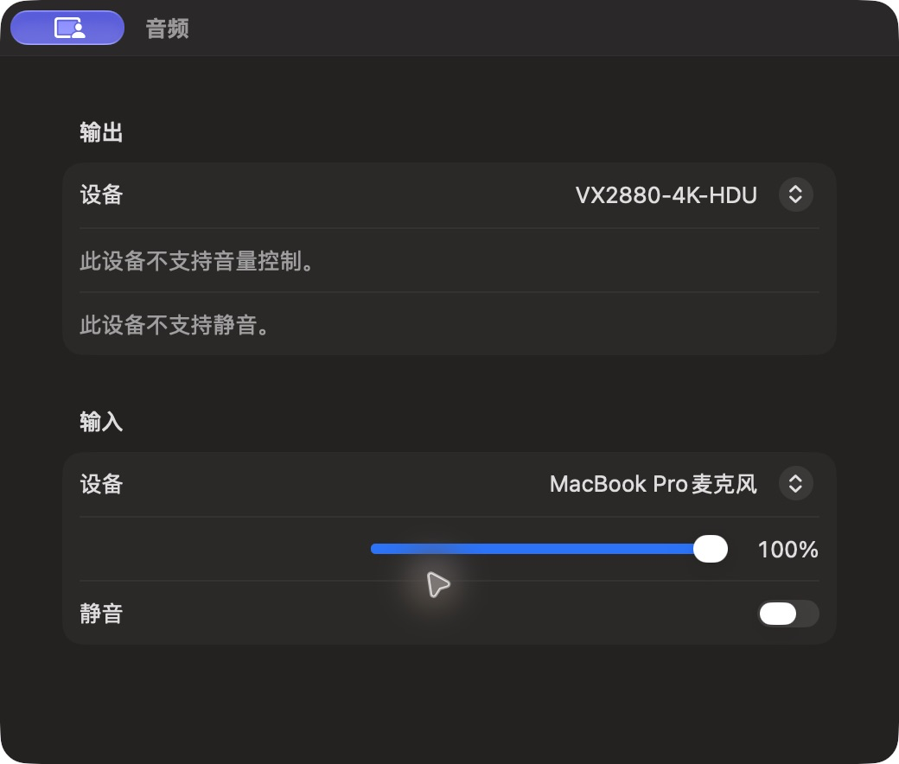

# 音频控制面板

批次 H · 2026-10-31 至 2026-11-01；dev `2f41c6a` 临时采集构建，版本 1.0（1）。

进入路径：主搜索 → 音频控制。

状态和操作：显示实际输入、输出设备与能力；未切换设备、音量或静音。



## 可见范围与构建差异

深色外观，仅当前实际可见窗口。截图转为真实 PNG，保留原始尺寸，未重绘。为工具导航临时增加普通菜单入口、启动时展示主搜索，放宽主搜索失焦关闭，并给截图选择浮层添加窗口标题元数据；业务命令仍经原有入口执行。这些临时源码在结束时全部恢复，不能用本批证明正式版本焦点行为正确。测试数据和恢复记录见总索引。

## 源码

`zbox/Plugins/Audio/AudioPlugin.swift:120`；文案资源 `zbox/Localizable.xcstrings`。以下局部摘录省略其余依赖，不能独立运行。

```swift
    var body: some View {
        VStack {
            if let direction = plugin.direction {
                TextField("Search Audio Devices", text: $plugin.query)
                    .textFieldStyle(.roundedBorder).focused($searchFocused)
                let devices = (plugin.states[direction]?.devices ?? []).filter {
                    plugin.query.isEmpty || $0.name.localizedStandardContains(plugin.query)
                }
                List(devices, selection: $selectedDevice) { device in
                    HStack {
                        Text(device.name)
                        Spacer()
                        if plugin.states[direction]?.selected == device.id {
                            Image(systemName: "checkmark").accessibilityLabel(Text("Current Device"))
                        }
                    }.tag(device.id)
                }
                Button("Use Device") {
                    if let id = selectedDevice ?? devices.first?.id { plugin.select(id, direction: direction) }
                }.keyboardShortcut(.defaultAction).disabled(devices.isEmpty)
            } else {
                Form {
                    ForEach(AudioDirection.allCases) { direction in
                        let state = plugin.states[direction] ?? AudioChannelState()
```
