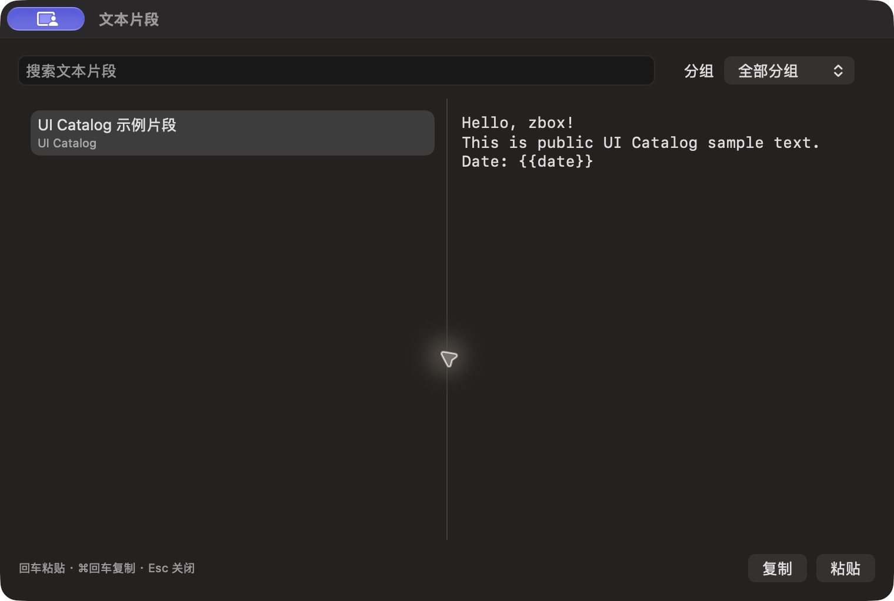

# 文本片段独立预览

批次 H · 2026-10-31 至 2026-11-01；dev `2f41c6a` 临时采集构建，版本 1.0（1）。

进入路径：主搜索 → 文本片段。

状态和操作：已选中 UI Catalog 示例片段，预览模板；未执行复制或粘贴。



## 可见范围与构建差异

深色外观，仅当前实际可见窗口。截图转为真实 PNG，保留原始尺寸，未重绘。为工具导航临时增加普通菜单入口、启动时展示主搜索，放宽主搜索失焦关闭，并给截图选择浮层添加窗口标题元数据；业务命令仍经原有入口执行。这些临时源码在结束时全部恢复，不能用本批证明正式版本焦点行为正确。测试数据和恢复记录见总索引。

## 源码

`zbox/Plugins/Snippets/SnippetsView.swift:6`；文案资源 `zbox/Localizable.xcstrings`。以下局部摘录省略其余依赖，不能独立运行。

```swift
    var body: some View {
        VStack(spacing: 12) {
            HStack {
                TextField("Search Snippets", text: $plugin.query).focused($searchFocused)
                Picker("Group", selection: $plugin.group) {
                    Text("All Groups").tag("")
                    ForEach(plugin.groups, id: \.self) { Text($0).tag($0) }
                }.frame(maxWidth: 180)
            }
            HSplitView {
                List(plugin.filteredItems, selection: $plugin.selectedID) { item in
                    VStack(alignment: .leading) {
                        Text(item.name)
                        if !item.group.isEmpty { Text(item.group).font(.caption).foregroundStyle(.secondary) }
                    }.tag(item.id)
                }.frame(minWidth: 180, idealWidth: 240)
                ScrollView {
                    Text(plugin.selectedItem?.body ?? String(localized: "No snippets found."))
                        .font(.system(.body, design: .monospaced))
                        .textSelection(.enabled)
                        .frame(maxWidth: .infinity, alignment: .topLeading).padding(12)
                }.frame(minWidth: 260)
            }
            if let error = plugin.store.loadError ?? plugin.statusMessage {
```
