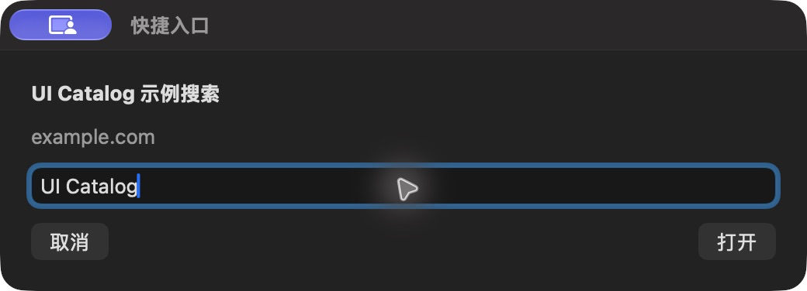

# 快捷入口运行参数

批次 H · 2026-10-31 至 2026-11-01；dev `2f41c6a` 临时采集构建，版本 1.0（1）。

进入路径：主搜索 → UI Catalog 示例搜索。

状态和操作：显示查询参数；取消表单，未打开网址。



## 可见范围与构建差异

深色外观，仅当前实际可见窗口。截图转为真实 PNG，保留原始尺寸，未重绘。为工具导航临时增加普通菜单入口、启动时展示主搜索，放宽主搜索失焦关闭，并给截图选择浮层添加窗口标题元数据；业务命令仍经原有入口执行。这些临时源码在结束时全部恢复，不能用本批证明正式版本焦点行为正确。测试数据和恢复记录见总索引。

## 源码

`zbox/Plugins/Quicklinks/QuicklinkParameterView.swift:10`；文案资源 `zbox/Localizable.xcstrings`。以下局部摘录省略其余依赖，不能独立运行。

```swift
    var body: some View {
        VStack(alignment: .leading, spacing: 12) {
            if plugin.choosingTemplate {
                Picker("Quicklink", selection: Binding(get: { plugin.parameterItem?.id }, set: { id in
                    plugin.parameterItem = plugin.store.items.first { $0.id == id }
                    plugin.parameterError = nil
                })) {
                    ForEach(plugin.store.items.filter { $0.kind == .template }) { item in
                        Text(item.name).tag(Optional(item.id))
                    }
                }
            } else { Text(plugin.parameterItem?.name ?? "").font(.headline) }
            Text((try? plugin.parameterItem?.destination().host) ?? "").foregroundStyle(.secondary)
            TextField(prompt, text: $plugin.query)
                .focused($focused)
                .onSubmit { plugin.openParameterizedLink() }
            if let error = plugin.parameterError { SettingsErrorView(message: error) }
            HStack {
                Button("Cancel") { plugin.stop() }.keyboardShortcut(.cancelAction)
                Spacer()
                Button("Open") { plugin.openParameterizedLink() }
                    .disabled(plugin.query.trimmingCharacters(in: .whitespacesAndNewlines).isEmpty)
            }
        }
```
