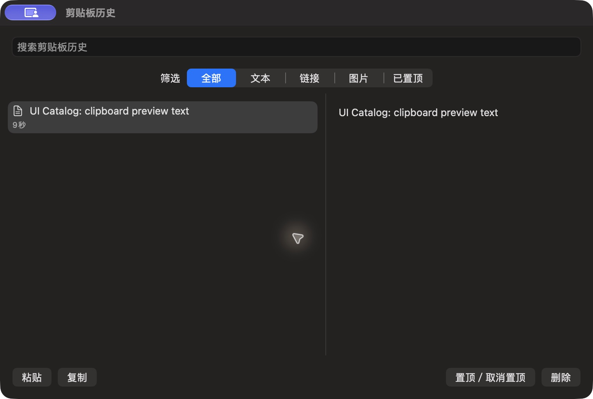

# 剪贴板公开文本预览

批次 H · 2026-10-31 至 2026-11-01；dev `2f41c6a` 临时采集构建，版本 1.0（1）。

进入路径：主搜索 → 剪贴板历史。

状态和操作：先准备公开剪贴板，再短暂开启记录，生成一条公开样例；采集后立即关闭记录。



## 可见范围与构建差异

深色外观，仅当前实际可见窗口。截图转为真实 PNG，保留原始尺寸，未重绘。为工具导航临时增加普通菜单入口、启动时展示主搜索，放宽主搜索失焦关闭，并给截图选择浮层添加窗口标题元数据；业务命令仍经原有入口执行。这些临时源码在结束时全部恢复，不能用本批证明正式版本焦点行为正确。测试数据和恢复记录见总索引。

## 源码

`zbox/Plugins/ClipboardHistory/ClipboardHistoryView.swift:7`；文案资源 `zbox/Localizable.xcstrings`。以下局部摘录省略其余依赖，不能独立运行。

```swift
    var body: some View {
        VStack(spacing: 0) {
            TextField("Search Clipboard History", text: $plugin.query)
                .textFieldStyle(.roundedBorder)
                .focused($searchFocused)
                .padding()
                .onSubmit { plugin.pasteSelection() }
            Picker("Filter", selection: $plugin.filter) {
                ForEach(ClipboardHistoryFilter.allCases) { Text($0.title).tag($0) }
            }.pickerStyle(.segmented).padding(.horizontal).padding(.bottom, 8)
            GeometryReader { geometry in
                HStack(spacing: 0) {
                    List(selection: $plugin.selectedID) {
                        ForEach(plugin.filteredEntries) { entry in
                            VStack(alignment: .leading, spacing: 4) {
                                HStack {
                                    Image(systemName: ["png", "tiff"].contains(entry.kind) ? "photo" : "doc.text")
                                    Text(entry.text).lineLimit(2)
                                    if entry.pinned { Image(systemName: "pin.fill").accessibilityLabel("Pinned") }
                                }
                                Text(entry.copiedAt, style: .relative).font(.caption).foregroundStyle(.secondary)
                            }
                            .tag(entry.id)
                        }
```
