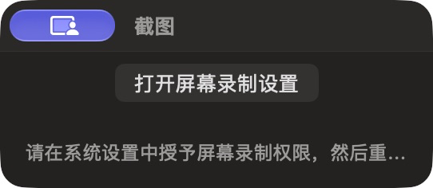

# 截图权限提示

批次 H · 2026-10-31 至 2026-11-01；dev `2f41c6a` 临时采集构建，版本 1.0（1）。

进入路径：主搜索 → 截图命令。

状态和操作：授权前自然出现的权限提示，底部文案可见区域受限；用户随后授予 zbox 权限，99–101 已展示实际捕获和 OCR。



## 可见范围与构建差异

深色外观，仅当前实际可见窗口。截图转为真实 PNG，保留原始尺寸，未重绘。为工具导航临时增加普通菜单入口、启动时展示主搜索，放宽主搜索失焦关闭，并给截图选择浮层添加窗口标题元数据；业务命令仍经原有入口执行。这些临时源码在结束时全部恢复，不能用本批证明正式版本焦点行为正确。测试数据和恢复记录见总索引。

## 源码

`zbox/Plugins/Screenshot/Editor/ScreenshotEditorView.swift:51`；文案资源 `zbox/Localizable.xcstrings`。以下局部摘录省略其余依赖，不能独立运行。

```swift
            if plugin.isExporting { ProgressView().controlSize(.small).padding(8) }
            if plugin.needsScreenRecordingPermission {
                Button("Open Screen Recording Settings", action: plugin.openScreenRecordingSettings).padding(8)
            }
            if let message = plugin.statusMessage {
                Text(message).font(.callout).foregroundStyle(.secondary).padding()
            }
        }
    }
}

private struct ScreenshotDocumentView: View {
    @Bindable var document: ScreenshotDocument
    var body: some View {
        VStack(spacing: 0) {
            HStack {
                Picker("Tool", selection: $document.tool) {
                    ForEach(ScreenshotTool.allCases) { Text($0.title).tag($0) }
                }.pickerStyle(.segmented)
                Button(action: document.undo) { Image(systemName: "arrow.uturn.backward") }
                    .help("Undo").accessibilityLabel("Undo").keyboardShortcut("z", modifiers: .command).disabled(!document.canUndo)
                Button(action: document.redo) { Image(systemName: "arrow.uturn.forward") }
                    .help("Redo").accessibilityLabel("Redo").keyboardShortcut("z", modifiers: [.command, .shift]).disabled(!document.canRedo)
            }.padding()
```
