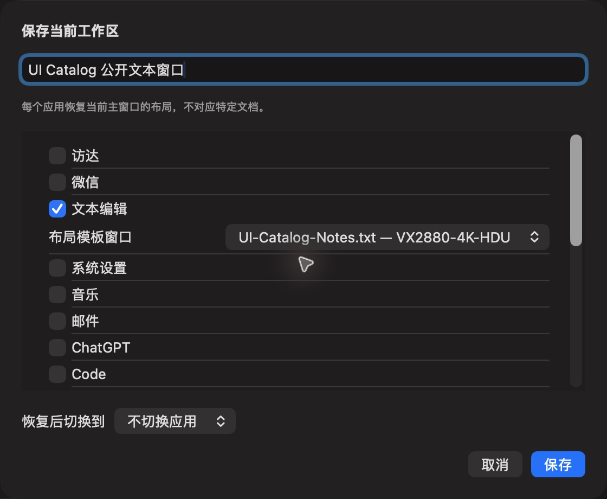

# 公开工作区窗口选择

批次 H · 2026-10-31 至 2026-11-01；dev `2f41c6a` 临时采集构建，版本 1.0（1）。

进入路径：设置 → 工作区 → 保存当前工作区。

状态和操作：仅勾选含公开测试文档的文本编辑窗口；其他应用未选中。保存为 UI Catalog 公开文本窗口。



## 可见范围与构建差异

深色外观，仅当前实际可见窗口。截图转为真实 PNG，保留原始尺寸，未重绘。为工具导航临时增加普通菜单入口、启动时展示主搜索，放宽主搜索失焦关闭，并给截图选择浮层添加窗口标题元数据；业务命令仍经原有入口执行。这些临时源码在结束时全部恢复，不能用本批证明正式版本焦点行为正确。测试数据和恢复记录见总索引。

## 源码

`zbox/Plugins/Workspace/WorkspaceSettingsView.swift:164`；文案资源 `zbox/Localizable.xcstrings`。以下局部摘录省略其余依赖，不能独立运行。

```swift
    var body: some View {
        VStack(alignment: .leading, spacing: 16) {
            Text("Save Current Workspace").font(.headline)
            TextField("Name", text: $name)
            if let errorMessage { SettingsErrorView(message: errorMessage) }
            Text("Each application restores its current main window, not a specific document.")
                .font(.caption).foregroundStyle(.secondary)
            List {
                ForEach(snapshot.applications) { app in
                    VStack(alignment: .leading) {
                        Toggle(app.name, isOn: Binding(get: { selection[app.id] != nil }, set: { enabled in
                            selection[app.id] = enabled ? app.windows.first?.id : nil
                            if !enabled, foreground == app.id { foreground = nil }
                        }))
                        if selection[app.id] != nil {
                            Picker("Layout window", selection: Binding(get: { selection[app.id] }, set: { selection[app.id] = $0 })) {
                                ForEach(app.windows) { window in
                                    Text(verbatim: "\(window.title) — \(window.entry.displayName)").tag(Optional(window.id))
                                }
                            }
                        }
                    }
                }
                if snapshot.applications.isEmpty { Text("No eligible windows on the current desktop.") }
```
