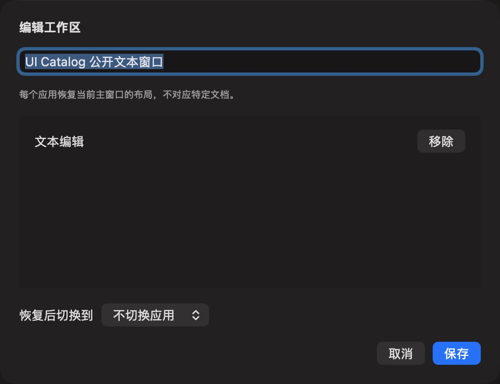

# 公开工作区编辑

批次 H · 2026-10-31 至 2026-11-01；dev `2f41c6a` 临时采集构建，版本 1.0（1）。

进入路径：设置 → 工作区 → UI Catalog 公开文本窗口 → 编辑。

状态和操作：显示已保存公开布局；取消编辑，未执行恢复布局。



## 可见范围与构建差异

深色外观，仅当前实际可见窗口。截图转为真实 PNG，保留原始尺寸，未重绘。为工具导航临时增加普通菜单入口、启动时展示主搜索，放宽主搜索失焦关闭，并给截图选择浮层添加窗口标题元数据；业务命令仍经原有入口执行。这些临时源码在结束时全部恢复，不能用本批证明正式版本焦点行为正确。测试数据和恢复记录见总索引。

## 源码

`zbox/Plugins/Workspace/WorkspaceSettingsView.swift:97`；文案资源 `zbox/Localizable.xcstrings`。以下局部摘录省略其余依赖，不能独立运行。

```swift
    var body: some View {
        VStack(alignment: .leading, spacing: 16) {
            Text("Edit Workspace").font(.headline)
            TextField("Name", text: $layout.name)
            if let errorMessage { SettingsErrorView(message: errorMessage) }
            Text("Each application restores its current main window, not a specific document.")
                .font(.caption).foregroundStyle(.secondary)
            List {
                ForEach(layout.entries) { entry in
                    HStack {
                        Text(entry.applicationName)
                        Spacer()
                        Button("Remove") {
                            layout.entries.removeAll { $0.id == entry.id }
                            if layout.foregroundBundleID == entry.id { layout.foregroundBundleID = nil }
                        }
                    }
                }
            }
            Picker("Activate after restoring", selection: $layout.foregroundBundleID) {
                Text("Do not activate").tag(String?.none)
                ForEach(layout.entries) { entry in
                    Text(entry.applicationName).tag(Optional(entry.bundleID))
                }
```
