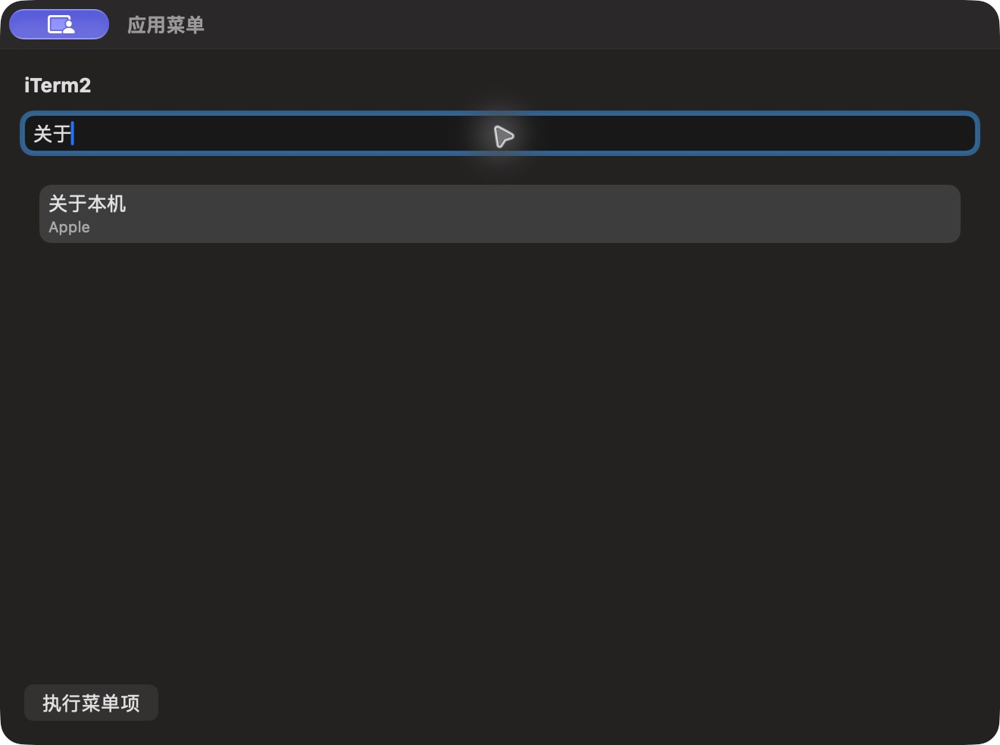

# 应用菜单搜索结果

批次 H · 2026-10-31 至 2026-11-01；dev `2f41c6a` 临时采集构建，版本 1.0（1）。

进入路径：主搜索 → 搜索应用菜单 → 关于。

状态和操作：实际目标为 iTerm2，仅显示关于本机菜单结果；未执行菜单项。



## 可见范围与构建差异

深色外观，仅当前实际可见窗口。截图转为真实 PNG，保留原始尺寸，未重绘。为工具导航临时增加普通菜单入口、启动时展示主搜索，放宽主搜索失焦关闭，并给截图选择浮层添加窗口标题元数据；业务命令仍经原有入口执行。这些临时源码在结束时全部恢复，不能用本批证明正式版本焦点行为正确。测试数据和恢复记录见总索引。

## 源码

`zbox/Plugins/AppMenu/AppMenuPlugin.swift:126`；文案资源 `zbox/Localizable.xcstrings`。以下局部摘录省略其余依赖，不能独立运行。

```swift
    var body: some View {
        VStack(alignment: .leading, spacing: 12) {
            Text(plugin.applicationName).font(.headline)
            TextField("Search Menu Items", text: $plugin.query).textFieldStyle(.roundedBorder).focused($searchFocused)
            if plugin.isLoading { ProgressView() }
            List(selection: Binding(get: { plugin.selected?.id }, set: { plugin.selectedID = $0 })) {
                ForEach(plugin.filteredItems) { item in
                    HStack {
                        VStack(alignment: .leading) {
                            Text(item.title)
                            Text(item.path).font(.caption).foregroundStyle(.secondary).lineLimit(1)
                        }
                        Spacer()
                        if item.marked { Image(systemName: "checkmark").accessibilityLabel(Text("Checked")) }
                        Text(item.shortcut).foregroundStyle(.secondary)
                        if !item.enabled { Text("Unavailable").font(.caption) }
                    }.foregroundStyle(item.enabled ? .primary : .secondary).tag(item.id)
                }
            }
            if !plugin.isLoading, plugin.filteredItems.isEmpty { Text("No menu items found.").foregroundStyle(.secondary) }
            if let message = plugin.statusMessage { SettingsErrorView(message: message) }
            Button("Execute Menu Item", action: plugin.executeSelection).disabled(plugin.selected?.enabled != true || plugin.isLoading)
        }.padding().onAppear { searchFocused = true }.onChange(of: plugin.query) { plugin.selectedID = nil }
    }
```
