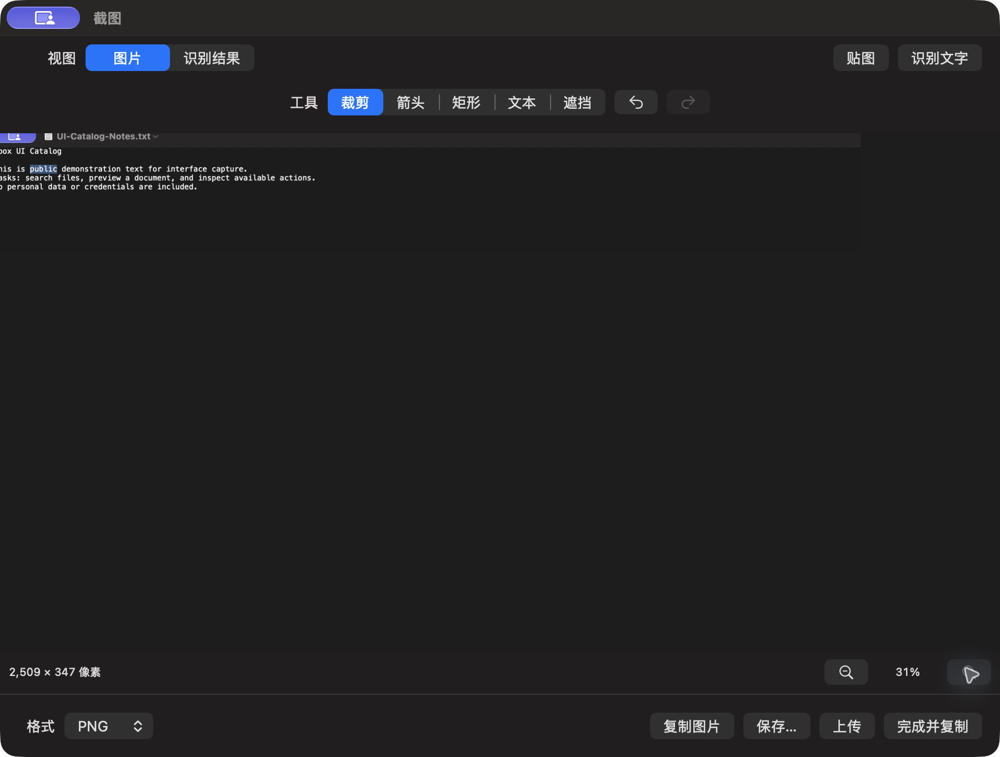

# 截图编辑与裁剪

批次 H · 2026-10-31 至 2026-11-01；dev `2f41c6a` 临时采集构建，版本 1.0（1）。

进入路径：主搜索 → 窗口截图 → 公开文本编辑窗口 → 裁剪。

状态和操作：应用内裁剪为 2509×347 像素，缩放31%；公开文档左侧少量文字被实际裁剪。未保存导出、复制或上传。



## 可见范围与构建差异

深色外观，仅当前实际可见窗口。截图转为真实 PNG，保留原始尺寸，未重绘。为工具导航临时增加普通菜单入口、启动时展示主搜索，放宽主搜索失焦关闭，并给截图选择浮层添加窗口标题元数据；业务命令仍经原有入口执行。这些临时源码在结束时全部恢复，不能用本批证明正式版本焦点行为正确。测试数据和恢复记录见总索引。

## 源码

`zbox/Plugins/Screenshot/Editor/ScreenshotEditorView.swift:64`；文案资源 `zbox/Localizable.xcstrings`。以下局部摘录省略其余依赖，不能独立运行。

```swift
    var body: some View {
        VStack(spacing: 0) {
            HStack {
                Picker("Tool", selection: $document.tool) {
                    ForEach(ScreenshotTool.allCases) { Text($0.title).tag($0) }
                }.pickerStyle(.segmented)
                Button(action: document.undo) { Image(systemName: "arrow.uturn.backward") }
                    .help("Undo").accessibilityLabel("Undo").keyboardShortcut("z", modifiers: .command).disabled(!document.canUndo)
                Button(action: document.redo) { Image(systemName: "arrow.uturn.forward") }
                    .help("Redo").accessibilityLabel("Redo").keyboardShortcut("z", modifiers: [.command, .shift]).disabled(!document.canRedo)
            }.padding()
            if document.tool == .text {
                TextField("Enter text, then click the image", text: $document.text).textFieldStyle(.roundedBorder).padding(.horizontal).padding(.bottom, 8)
            }
            ScrollView([.horizontal, .vertical]) {
                ScreenshotCanvas(document: document)
                    .frame(width: document.edit.crop.width * document.zoom, height: document.edit.crop.height * document.zoom)
            }.frame(maxWidth: .infinity, maxHeight: .infinity).background(.black.opacity(0.08))
            HStack {
                Text("\(Int(document.edit.crop.width)) × \(Int(document.edit.crop.height)) px").monospacedDigit()
                Spacer()
                Button { document.zoom = max(0.05, document.zoom / 1.25) } label: { Image(systemName: "minus.magnifyingglass") }
                    .accessibilityLabel("Zoom Out")
                Text(document.zoom, format: .percent.precision(.fractionLength(0))).monospacedDigit().frame(width: 55)
```
